# Density Estimation: K-Nearest Neighbors, Gaussian KDE, and Histograms

## I. Overview

This project was completed for a Data Mining course and explores three non-parametric density estimation methods using Python: **K-Nearest Neighbor (KNN) density estimation**, **Gaussian Kernel Density Estimation (KDE)**, and **histogram density estimation**. The goal is to compare estimated probability densities with known distributions and examine how sample size (`N`), number of neighbors (`K`), and histogram bin count affect the results.

The program generates synthetic samples from a Gaussian distribution and a mixture of two uniform distributions. It plots the sample points (for the KNN and KDE experiments), true density, and estimated density. A fixed random seed (`0`) is used for reproducibility.

## II. Data Generation

### 2.1 Gaussian Distribution

- Mean: `μ = 1.0`
- Variance: `σ² = 2.0`
- Samples are drawn independently from the Gaussian distribution.
- True and estimated densities are evaluated at **10,000** linearly spaced values from `-7` to `9`.

### 2.2 Mixture Distribution

The second distribution is a weighted mixture of two uniform densities:

$$f(x) = 0.4f_1(x) + 0.6f_2(x)$$

- `f1(x) = 1` for `2 ≤ x ≤ 3`, and `0` otherwise.
- `f2(x) = 0.2` for `15 ≤ x ≤ 20`, and `0` otherwise.
- Thus, the true mixture density is `0.4` on `[2, 3]`, `0.12` on `[15, 20]`, and zero elsewhere.
- True and estimated densities are evaluated at **10,000** linearly spaced values from `0` to `22`.

## III. Density Estimation Experiments

### 3.1 Q1: KNN Density Estimation for Gaussian Data

KNN density estimation uses the distance `r` from a query point to its `K`-th nearest sample. For the one-dimensional experiments, the neighborhood length is `2r`, so the estimate is:

$$\hat{f}(x) = \frac{K}{N(2r)}$$

The program tests six `(N, K)` combinations:

| Number of samples (`N`) | Neighbors (`K`) |
| ---: | ---: |
| 1 | 1 |
| 10 | 2 |
| 10 | 10 |
| 1,000 | 10 |
| 1,000 | 100 |
| 50,000 | 50,000 |

For each combination, the program plots the true Gaussian density, its KNN estimate, and the sample points. If the neighborhood length is zero, the KNN estimator returns infinity.

### 3.2 Q2: KNN Density Estimation for Mixture Data

Q2 repeats the same six `(N, K)` combinations using the mixture of two uniform distributions. Each plot compares the estimated density with the two separated regions of the true mixture density.

### 3.3 Q3: Gaussian Kernel Density Estimation

Gaussian KDE places a Gaussian kernel at each sample point and averages the kernel contributions to estimate the mixture density:

$$\hat{f}(x) = \frac{1}{N\sigma} \sum_{i=1}^{N} \frac{1}{\sqrt{2\pi}} \exp\left(-\frac{1}{2}\left(\frac{x-x_i}{\sigma}\right)^2\right)$$

- Sample sizes: `N = 1, 2, 5, 10, 50, 100, 1000`
- Gaussian kernel bandwidth: `σ = 1.0`
- Seven figures compare the true mixture density with the KDE estimates and show the sample points.

### 3.4 Q4: Histogram Density Estimation

Histograms estimate the mixture density by dividing the sampled range into bins and normalizing their counts to represent density.

- Sample sizes: `N = 5, 10, 500`
- Number of bins: `2, 5, 20`
- Each sample size is tested with each bin count, producing **nine histograms**.
- Each figure displays the histogram density estimate alongside the true mixture density.

## IV. Observations

- **Small `K` values** produce sharp peaks and noisy KNN estimates because the neighborhood is strongly influenced by local sample spacing.
- **Increasing `K`** generally smooths the KNN estimate. However, when `K` becomes very large relative to `N`, the estimate can become overly broad and lose important features of the true distribution.
- For the **mixture distribution**, moderate neighbor counts represent the two separated density regions more effectively than extremely small or extremely large neighbor counts in the experiments.
- **Gaussian KDE** becomes more stable as the sample size increases. Its smooth kernels blur the abrupt boundaries of the underlying uniform distributions.
- **Histograms with few bins** can miss important features, while many bins with too few samples produce sparse, irregular estimates. Larger samples make more detailed histograms useful.

Overall, the experiments demonstrate how the choice of density estimation method and its parameters influences the smoothness and accuracy of estimated probability densities.

## V. Project Files

| File | Description |
| --- | --- |
| `Density_Estimation.py` | Base class that stores the sample data. |
| `Knn_Density_Estimation.py` | KNN density estimation using distances to nearest neighbors. |
| `Kernel_Density_Estimation.py` | Gaussian kernel density estimator. |
| `Gaussian_Density.py` | Generates Gaussian samples and calculates the true Gaussian density. |
| `Mixture_Density.py` | Generates samples from the two-uniform mixture and calculates its true density. |
| `Density_Experiments.py` | Main program for Q1–Q4 and saving the figures. |

## VI. Running the Program

```bash
python Density_Experiments.py
```

The program generates **28 PNG figures** in the current working directory:

- six Gaussian KNN plots
  
  
  
  
  
  
  

- six mixture KNN plots
  
  
  
  
  
  
  

- seven Gaussian KDE plots
  
  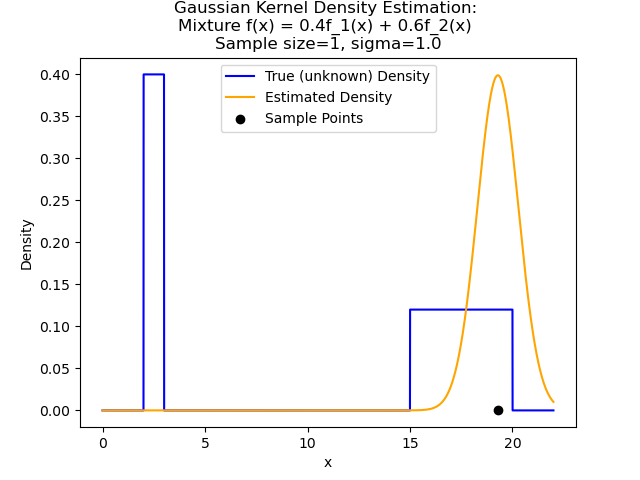
  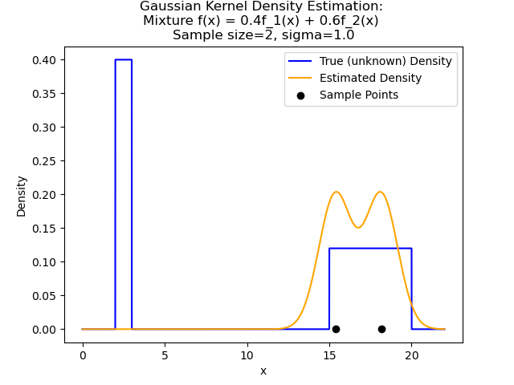
  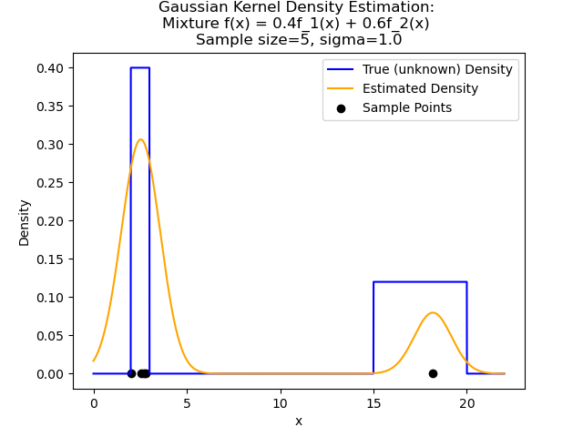
  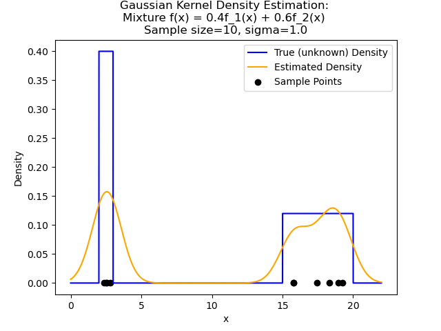
  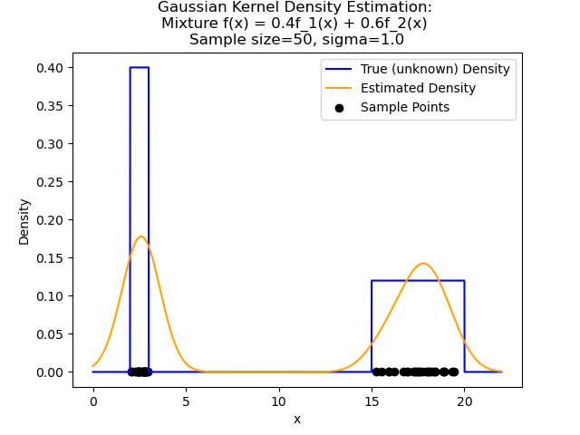
  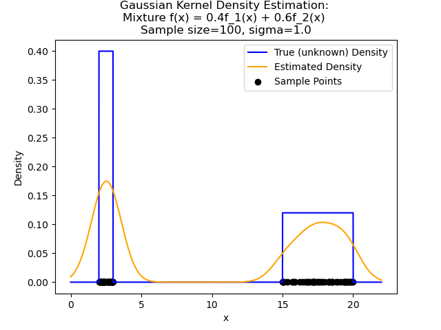
  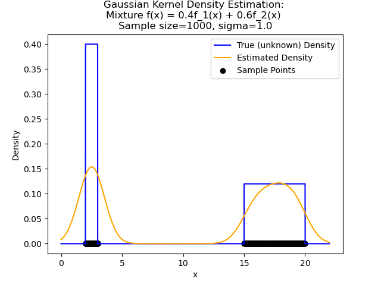

- nine histogram plots.
  
  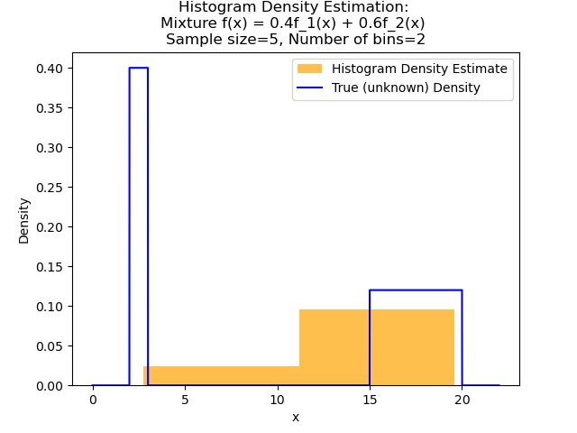
  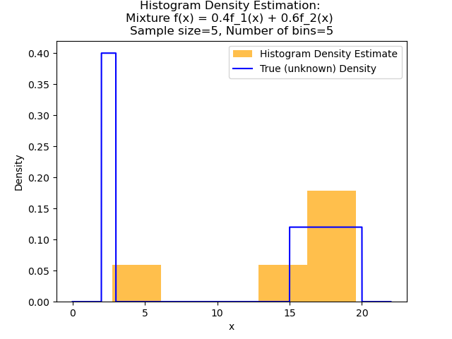
  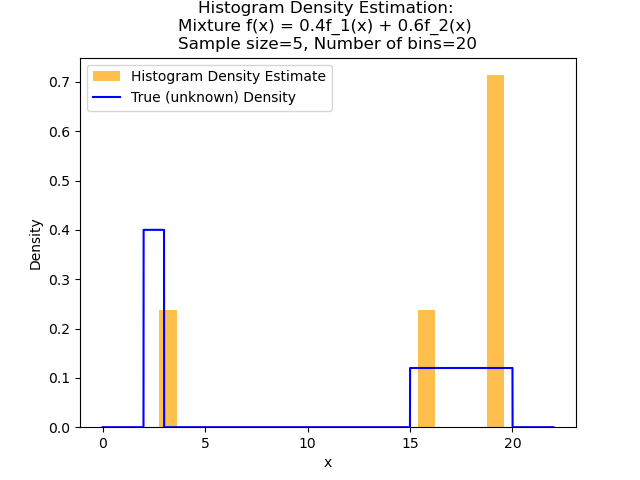
  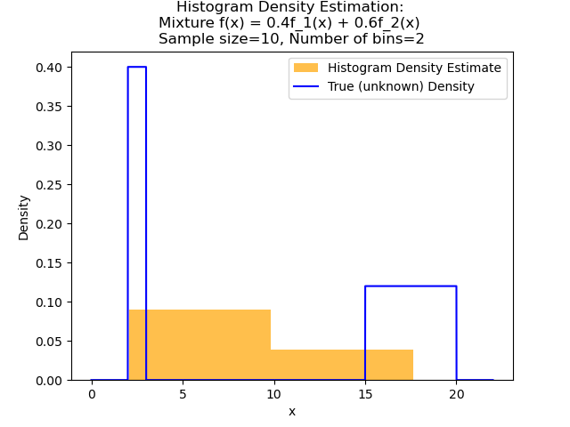
  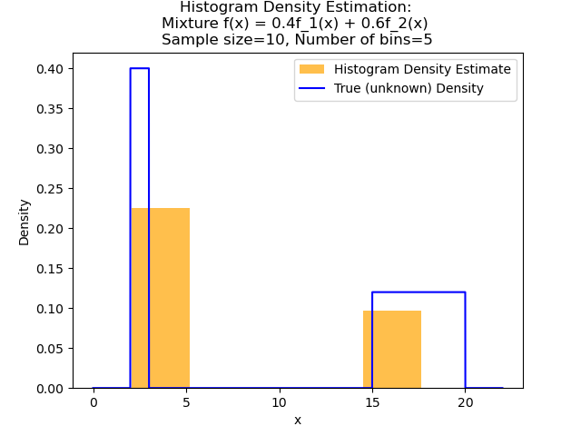
  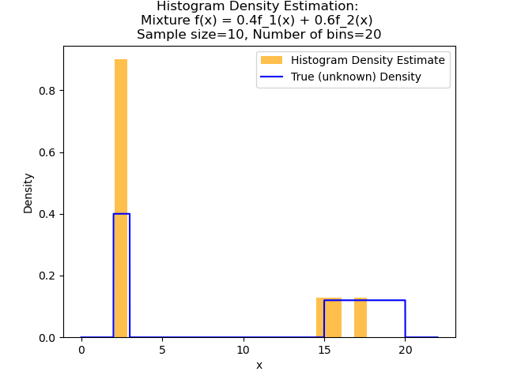
  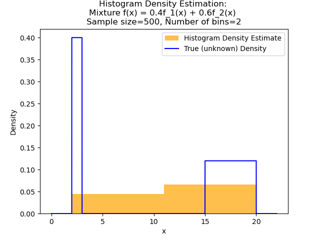
  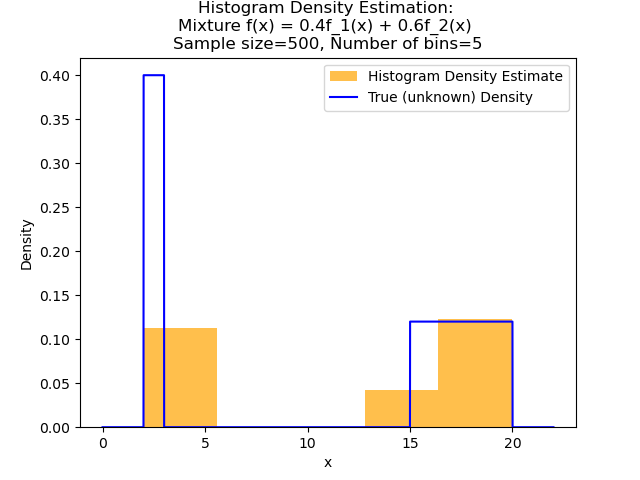
  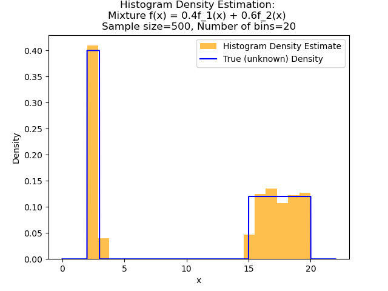
